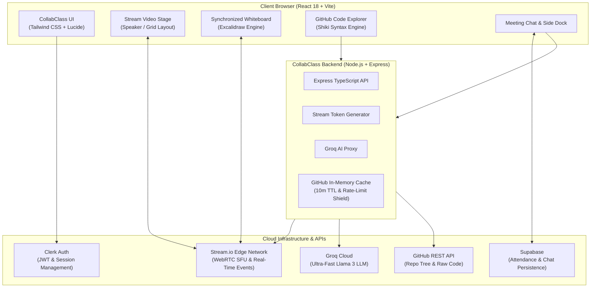

<div align="center">

# 🎓 CollabClass

### **The Modern Collaborative Virtual Classroom & Developer Learning Workspace**

[](https://collabnclass.vercel.app)
[](https://github.com/TanmayNileshShinde/collabnclass/stargazers)
[](https://github.com/TanmayNileshShinde/collabnclass/network/members)
[](https://github.com/TanmayNileshShinde/collabnclass/issues)
[](./LICENSE)

<br/>

**CollabClass** is a high-performance, full-stack virtual classroom and developer collaboration platform. Built with **React 18**, **TypeScript**, **Stream.io WebRTC**, **Clerk Auth**, **Supabase**, and **Groq AI**, it unites crystal-clear video conferencing, real-time multi-user whiteboarding, in-meeting GitHub repository code exploration, and intelligent AI tutoring into a unified cyber-themed workspace.

[Explore Live Classroom](https://collabnclass.vercel.app) · [Report Bug](https://github.com/TanmayNileshShinde/collabnclass/issues) · [Request Feature](https://github.com/TanmayNileshShinde/collabnclass/issues)

</div>

---

## 🌟 Core Superpowers

| Feature | Description | Stack / Tech |
|---|---|---|
| **🎥 Real-Time HD Video & Audio** | Low-latency WebRTC group video conferencing with dynamic grid, speaker spotlight, and active-speaker audio waveform detection. | Stream.io Video React SDK |
| **🎨 Multi-User Whiteboard Sync** | Real-time synchronized whiteboard canvas with peer event broadcasting and one-click export to PNG, SVG, or JSON. | Excalidraw + Custom Events |
| **🐙 In-Session GitHub Explorer** | Import any public repository, lazily expand file trees, and view syntax-highlighted code with binary preview protection. | Shiki + Backend Caching |
| **🤖 AI Study Tutor** | Instant contextual code explanations, meeting summaries, and study assistance directly in the dock. | Groq SDK (Llama 3) |
| **💬 Persistent In-Meeting Chat** | Real-time chat with local caching and peer history reconciliation across reconnections. | Supabase + Stream Custom State |
| **✋ Classroom Management** | Interactive hand-raising queue, live attendance tracking beacons, and classroom concluded dismissal modals. | Web Beacons + Stream State |
| **🌓 Theme Engine** | High-contrast Ocean Cyberpunk aesthetic with dual-layer crossfade synchronization and zero flash. | Tailwind CSS + Custom CSS Variables |

---

## 🏗️ System Architecture



---

## 💻 Tech Stack & Arsenal

### Frontend
- **Framework:** React 18, TypeScript, Vite
- **Styling & UI:** Tailwind CSS, Radix UI Primitives, Lucide Icons, Class Variance Authority
- **Real-Time Video & Events:** `@stream-io/video-react-sdk`
- **Whiteboard:** `@excalidraw/excalidraw`
- **Syntax Highlighting:** `shiki`
- **Authentication:** `@clerk/clerk-react`
- **Database Client:** `@supabase/supabase-js`

### Backend
- **Runtime:** Node.js with Express & TypeScript
- **AI Engine:** Groq Cloud SDK (`groq-sdk`)
- **Video Tokens:** `@stream-io/node-sdk`
- **Auth Verification:** `@clerk/clerk-sdk-node`
- **Network & Caching:** Axios with custom in-memory TTL caching

---

## 🚀 Getting Started

### 1. Prerequisites
- **Node.js:** `v18.0.0` or higher
- **npm** or **pnpm**
- Active accounts & API keys for:
  - [Clerk](https://clerk.com)
  - [Stream](https://getstream.io)
  - [Supabase](https://supabase.com)
  - [Groq](https://groq.com)

### 2. Clone and Install

```bash
git clone https://github.com/TanmayNileshShinde/collabnclass.git
cd collabnclass

# Install dependencies across root, frontend, and backend
npm run install:all
```

### 3. Environment Variables

#### Backend (`backend/.env`):
```env
PORT=4000
FRONTEND_URL=http://localhost:3000
STREAM_API_KEY=your_stream_api_key
STREAM_SECRET_KEY=your_stream_secret_key
CLERK_SECRET_KEY=your_clerk_secret_key
GITHUB_TOKEN=your_optional_github_token
GROQ_API_KEY=your_groq_api_key
```

#### Frontend (`frontend/.env`):
```env
VITE_CLERK_PUBLISHABLE_KEY=your_clerk_publishable_key
VITE_STREAM_API_KEY=your_stream_api_key
VITE_BASE_URL=http://localhost:3000
VITE_BE_URL=http://localhost:4000
VITE_SUPABASE_URL=your_supabase_url
VITE_SUPABASE_ANON_KEY=your_supabase_anon_key
```

### 4. Run Locally

```bash
# Start both frontend and backend concurrently
npm run dev
```

- **Frontend:** `http://localhost:3000`
- **Backend:** `http://localhost:4000`

---

## 📁 Repository Structure

```text
collabnclass/
├── frontend/                     # React 18 + TypeScript + Vite
│   ├── src/
│   │   ├── components/           # UI Components
│   │   │   ├── MeetingRoom.tsx   # Core Stage, Dock & Ended Modal
│   │   │   ├── Whiteboard.tsx    # Excalidraw real-time canvas & export
│   │   │   ├── GithubRepoImporter.tsx # Shiki code viewer & lazy loader
│   │   │   ├── MeetingSideDock.tsx    # Dock tabs & active speaker pill
│   │   │   └── MeetingChat.tsx   # Persistent in-meeting chat
│   │   ├── contexts/             # Chat, Classroom & Theme Providers
│   │   ├── pages/                # Route views (Home, Meeting, Landing)
│   │   └── lib/                  # Utilities & meeting helpers
├── backend/                      # Express TypeScript Server
│   └── src/
│       ├── routes/               # Modular API routes
│       │   ├── stream.ts         # Stream WebRTC token generator
│       │   ├── github.ts         # In-memory cached GitHub explorer
│       │   └── chatbot.ts        # Groq Llama 3 AI endpoint
│       └── server.ts             # Express server entry point
└── README.md                     # Flagship Documentation
```

---

## 🤝 Contributing

Contributions, issues, and feature requests are welcome!

1. Fork the Project
2. Create your Feature Branch (`git checkout -b feat/amazing-feature`)
3. Commit your Changes (`git commit -m 'feat: add amazing feature'`)
4. Push to the Branch (`git push origin feat/amazing-feature`)
5. Open a Pull Request

---

## ⭐ Support & Stargazers

If CollabClass helped you learn something new or inspired your next project, **please give it a star on GitHub!** It helps the project grow and reach more developers.

<div align="center">

[](https://github.com/TanmayNileshShinde/collabnclass)

Made with ❤️ by [Tanmay Nilesh Shinde](https://github.com/TanmayNileshShinde)

</div>
